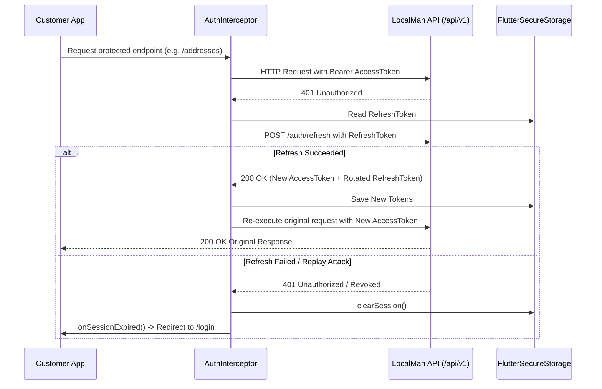

# LocalMan Customer Mobile Application Architecture (Phase 3A)

## 1. Overview & System Mission

The **LocalMan Customer Mobile Application** (`apps/customer_app`) provides a clean, trustworthy, and high-performance mobile interface for customers in India seeking verified local home services (Plumbing, Electrical, AC & Appliance Repair, House Cleaning, Carpentry, Painting, Pest Control, Moving & Packers).

Built on Flutter with Google Material 3 and modern aesthetic guidelines, the customer application is designed strictly as a production-grade client that consumes the authoritative backend API.

---

## 2. Directory & Component Structure

```
apps/customer_app/
├── android/
│   ├── app/
│   │   ├── build.gradle            # namespace: in.localman.customer, minSdk 21, targetSdk 34
│   │   └── src/main/
│   │       ├── AndroidManifest.xml # Minimal permissions (Internet, Foreground GPS only)
│   │       └── kotlin/in/localman/customer/MainActivity.kt
│   ├── build.gradle
│   └── settings.gradle
├── ios/
│   └── Runner/
│       ├── AppDelegate.swift
│       └── Info.plist              # CFBundleIdentifier: in.localman.customer, NSLocationWhenInUse
├── lib/
│   ├── core/
│   │   ├── config/
│   │   │   └── env_config.dart     # Environment resolution (dev/staging/prod) & HTTPS enforcement
│   │   ├── constants/
│   │   │   └── api_constants.dart  # Dynamic API URI builders
│   │   ├── errors/
│   │   │   ├── api_error.dart      # Structured server and network error model
│   │   │   └── app_exception.dart  # AppException hierarchy (Network, Validation, Unauthorized, Server)
│   │   ├── network/
│   │   │   ├── api_client.dart     # Standardized Dio client with sanitization & structured mapping
│   │   │   └── auth_interceptor.dart # QueuedInterceptor with 401 token refresh queue
│   │   ├── routing/
│   │   │   └── app_router.dart     # GoRouter with authentication guards & deep-link validation
│   │   ├── storage/
│   │   │   └── token_storage.dart  # EncryptedSharedPreferences / Keychain FlutterSecureStorage
│   │   └── theme/
│   │       └── app_theme.dart      # Slate + Amber + Teal theme with Plus Jakarta Sans typography
│   ├── features/
│   │   ├── auth/
│   │   │   ├── data/
│   │   │   │   └── auth_repository.dart
│   │   │   ├── domain/
│   │   │   │   ├── user.dart
│   │   │   │   └── auth_session.dart
│   │   │   └── presentation/
│   │   │       ├── controllers/
│   │   │       │   └── auth_provider.dart
│   │   │       └── screens/
│   │   │           ├── phone_input_screen.dart
│   │   │           └── otp_verify_screen.dart
│   │   ├── profile/
│   │   │   ├── data/
│   │   │   │   └── customer_repository.dart
│   │   │   ├── domain/
│   │   │   │   └── customer_profile.dart
│   │   │   └── presentation/
│   │   │       ├── controllers/
│   │   │       │   └── profile_provider.dart
│   │   │       └── screens/
│   │   │           └── profile_screen.dart
│   │   ├── addresses/
│   │   │   ├── data/
│   │   │   │   └── address_repository.dart
│   │   │   ├── domain/
│   │   │   │   └── address.dart
│   │   │   └── presentation/
│   │   │       ├── controllers/
│   │   │       │   └── address_provider.dart
│   │   │       └── screens/
│   │   │           ├── address_list_screen.dart
│   │   │           └── address_edit_screen.dart
│   │   ├── home/
│   │   │   └── presentation/
│   │   │       └── screens/
│   │   │           └── customer_home_screen.dart # "What do you need done?" Hero & Categories
│   │   ├── bookings/
│   │   │   └── presentation/
│   │   │       └── screens/
│   │   │           ├── bookings_list_screen.dart # Verified empty state
│   │   │           └── booking_details_screen.dart # Parameter-validated booking details
│   │   └── support/
│   │       └── presentation/
│   │           └── screens/
│   │               └── support_screen.dart # Toll-free helpline, Grievance Officer, FAQs
│   ├── shared/
│   │   └── widgets/
│   │       ├── empty_state_view.dart
│   │       ├── error_view.dart
│   │       └── loading_indicator.dart
│   └── main.dart
├── test/
│   ├── address_test.dart
│   ├── auth_test.dart
│   ├── repositories_test.dart
│   └── router_test.dart
└── pubspec.yaml
```

---

## 3. Native App Scaffolding & Security Isolation

- **Android Package / Namespace:** `in.localman.customer`
- **Application ID:** `in.localman.customer`
- **Target SDK:** 34 (Android 14)
- **Minimum SDK:** 21 (Android 5.0)
- **iOS Bundle Identifier:** `in.localman.customer`
- **iOS Display Name:** `LocalMan`
- **Permissions Policy:**
  - Foreground internet: `android.permission.INTERNET`, `android.permission.ACCESS_NETWORK_STATE`
  - Foreground location: `ACCESS_FINE_LOCATION`, `ACCESS_COARSE_LOCATION` (Android), `NSLocationWhenInUseUsageDescription` (iOS). Used solely for detecting neighborhood address and dispatch calculations.
  - **Zero Background Location:** Background GPS is not requested on the customer app.
  - **Zero Camera/Microphone:** Camera and audio hardware permissions are omitted until media-based dispute uploads or chat are scheduled.

---

## 4. Environment Configuration

The app uses `EnvConfig` supporting `development`, `staging`, and `production`:

```bash
# Development (Android Emulator default: http://10.0.2.2:4000/api/v1)
flutter run

# Staging
flutter run --dart-define=ENV=staging --dart-define=API_BASE_URL=https://staging-api.localman.in/api/v1

# Production Release
flutter build apk --release --dart-define=ENV=production --dart-define=API_BASE_URL=https://api.localman.in/api/v1
```

**Security Guarantees:**
1. **Mandatory HTTPS in Release:** In `kReleaseMode`, if `API_BASE_URL` does not start with `https://`, initialization throws a terminating `StateError`.
2. **Zero Inlined Backend Secrets:** Neither database passwords, SMS gateway API keys, nor JWT signing secrets are bundled inside Flutter client bytecode.

---

## 5. Network Layer & Authentication Interceptor

### Standardized HTTP Client (`ApiClient`)
- Timeouts: 15 seconds connect, receive, and send timeout.
- Development-only logging: In `!kReleaseMode`, network headers and bodies are logged with strict redaction of sensitive keys (`otp`, `authorization`, `accessToken`, `refreshToken`, `password`, `panNumber`, `bankAccountNumber`, `upiId`).
- Release builds produce zero console logs.

### Queued Token Refresh Interceptor (`AuthInterceptor`)


---

## 6. Secure Authentication & Session Lifecycle

1. **OTP Request:** Customer enters 10-digit Indian phone number (`/api/v1/auth/otp/send` with `role: 'CUSTOMER'`).
2. **OTP Verification:** Customer submits 6-digit SMS OTP (`/api/v1/auth/otp/verify`).
3. **Session Persistence:** Returned `accessToken` and `refreshToken` are written to encrypted local storage (`EncryptedSharedPreferences` on Android, `Keychain` with `first_unlock` accessibility on iOS).
4. **Session Restore:** On cold launch, `AuthNotifier` reads stored tokens and verifies the session via `GET /api/v1/auth/me`. If invalid or revoked, storage is cleared and user is routed to `/login`.
5. **No Demo / Prefilled Data:** All mock OTPs, bypass buttons, and hardcoded user sessions have been permanently removed.

---

## 7. Customer User & Address Domain Models

### User Model (`User`)
- `id`: Server-generated UUID (`usr_...`).
- `phoneNumber`: E.164-compliant mobile number.
- `fullName`: Optional customer display name.
- `email`: Optional email for invoices.
- `preferredLanguage`: Locale preference (default `en`).
- `roles`: RBAC roles (`['CUSTOMER']`).
- `isProfileComplete`: Boolean flag computed server-side.

### Address Model (`Address`)
- `id`: Server UUID (`addr_...`).
- `userId`: Authoritative user link.
- `label`: Friendly label (`Home`, `Work`, `Other`).
- `addressLine1`, `addressLine2`, `landmark`: Structured street address.
- `city`, `state`: Locality identifiers.
- `postalCode`: 6-digit Indian PIN code (`/^[1-9][0-9]{5}$/`).
- `latitude`, `longitude`: Coordinate floating point numbers.
- `isDefault`: Boolean indicating whether this is the primary booking address.
- `formattedAddress`: Display string for app bars and cards.

---

## 8. Routing Architecture & Route Guards

Defined in `lib/core/routing/app_router.dart`:

| Route | Access | Screen | Guard Behavior |
| :--- | :--- | :--- | :--- |
| `/home` | Public | `CustomerHomeScreen` | Shell screen; accessible to all |
| `/login` | Unauthenticated | `PhoneInputScreen` | Redirects to `/home` if already authenticated |
| `/otp` | Unauthenticated | `OtpVerifyScreen` | Redirects to `/home` if already authenticated |
| `/profile` | Authenticated | `ProfileScreen` | Redirects to `/login` if unauthenticated |
| `/addresses` | Authenticated | `AddressListScreen` | Redirects to `/login` if unauthenticated |
| `/addresses/new` | Authenticated | `AddressEditScreen` | Redirects to `/login` if unauthenticated |
| `/addresses/edit` | Authenticated | `AddressEditScreen` | Redirects to `/login` if unauthenticated |
| `/bookings` | Authenticated | `BookingsListScreen` | Redirects to `/login` if unauthenticated |
| `/booking/:id` | Authenticated | `BookingDetailsScreen` | Validates `:id`; redirects to `/login` if unauthenticated |
| `/support` | Public | `SupportScreen` | Accessible to all customers |

---

## 9. Backend Address Module & IDOR Protection

In accordance with Phase 3A requirements, backend address endpoints were created under `/api/v1/addresses`:
- `GET /api/v1/addresses`: Lists saved addresses for `request.user.id`.
- `POST /api/v1/addresses`: Creates an address. If `isDefault: true` or this is the user's first address, existing defaults for that user are atomically unset.
- `PUT /api/v1/addresses/:id`: Updates an address. Strictly checks `address.userId === request.user.id`. If non-matching, returns `403 Forbidden`.
- `PATCH /api/v1/addresses/:id/default`: Promotes address to default within a transaction.
- `DELETE /api/v1/addresses/:id`: Deletes address. If deleting the default address and remaining addresses exist, promotes the most recent remaining address to default.

---

## 10. Customer Home Screen Architecture

The Customer Home Shell (`customer_home_screen.dart`) is built around the primary LocalMan value proposition:
- **Hero Message:** *"What do you need done?"*
- **Address Selector:** Displays active delivery address or prompts selection.
- **Service Categories Grid:** Fast visual access to Plumbing, Electrician, AC & Appliance, Cleaning, Carpentry, Pest Control, Painting, and Packers.
- **Verified Local Guarantee Card:** Police & Aadhaar-verified pros, transparent upfront pricing, OTP-guarded job start.
- **Empty States:** When no active bookings or addresses exist, friendly, actionable empty views guide the customer without fabricating fake bookings or historical records.

---

## 11. Testing & Quality Assurance

- **Backend Address & Auth Suites:** 134 automated tests across 20 suites passing in `apps/api`.
- **Flutter Unit & Contract Tests:**
  - `test/auth_test.dart`: OTP send, verify, token persistence, session restore, expired token clearing, and logout.
  - `test/router_test.dart`: Authentication guards, unauthenticated redirection, authenticated bypass, and deep-link validation.
  - `test/repositories_test.dart`: DTO serialization, 422 validation mapping, 401 unauthorized handling, timeout detection, and offline handling.
  - `test/address_test.dart`: Address creation, default promotion, multi-address default un-setting, and deletion promotion.
