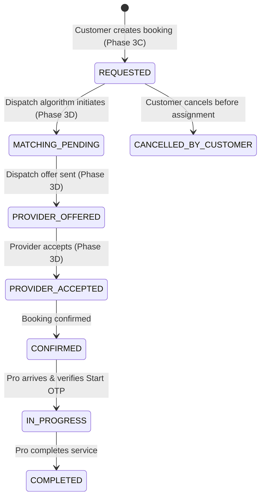

# LocalMan Phase 3C — Customer Booking Creation, Job Details & Scheduling Architecture

## 1. Overview & Objective

Phase 3C establishes the backend-authoritative customer booking creation flow for the LocalMan marketplace. Customers can select a service, select a verified delivery address, specify job requirements, configure scheduling preferences, review authoritative pricing, and submit a booking request protected by idempotency guarantees.

All booking records, status progressions, and financial derivations are generated strictly on the server. The customer client is strictly a presentation and request submission layer.

---

## 2. Core Architectural Guarantees

1. **Server Authority**: The backend is the sole authority for:
   - Generating booking identifiers (`id`, `bookingNumber`)
   - Initial booking status (`REQUESTED`)
   - 6-digit Service Start OTP generation
   - Financial amounts (`totalAmountPaisa`, `platformFee`, `tax`)
   - Address and Service snapshot creation
   - Verification of service active status and category active status.
2. **Immutable Historical Snapshots**:
   - `addressSnapshot`: Freezes customer address line 1/2, landmark, city, state, postal code, and coordinates at booking time. Changes to saved addresses in the customer profile never alter historical bookings.
   - `serviceSnapshot`: Freezes service name, slug, and category name at booking time.
   - `pricingSnapshot`: Freezes the pricing model, base rates, hourly rates, or inspection fees in integer paisa.
3. **Idempotency Protection**:
   - Every booking creation request supports an `Idempotency-Key` (header or payload).
   - The server stores the key with a SHA-256 hash of the canonical request payload.
   - Retries with the identical key and payload return the previously created booking record safely (HTTP 200/201).
   - Re-use of the same idempotency key with a materially different payload is rejected with `HTTP 409 Conflict`.
4. **Strict IDOR & Ownership Validation**:
   - The requested address is verified against `address.userId === customer.id`. Unowned addresses are rejected with `HTTP 403 Forbidden`.
   - Access to booking lists and booking details enforces customer ownership (`booking.customerId === customer.id`). Unauthorized access returns `HTTP 403 Forbidden`. Nonexistent bookings return `HTTP 404 Not Found`.

---

## 3. Booking Lifecycle & FSM Integration

Customer booking creation enters the existing LocalMan Booking Finite State Machine (FSM):



### Audit Trail
Every transition writes a permanent record to `BookingStatusHistory`:
- `bookingId`: Target booking
- `fromStatus`: `null` (on creation)
- `toStatus`: `REQUESTED`
- `reason`: `"Customer requested booking"`
- `changedBy`: Customer User ID
- `createdAt`: UTC timestamp

---

## 4. Pricing Models & Calculation Rules

LocalMan supports four authoritative pricing models. All monetary calculations are performed strictly using integer paisa (1 INR = 100 paisa) to eliminate floating-point rounding errors.

| Pricing Model | Client Parameters | Authoritative Server Calculation | Snapshot Fields |
|---|---|---|---|
| `FIXED_PRICE` | `serviceId`, `addressId`, `scheduledDate` | `basePricePaisa` from catalog + configured fees | `basePricePaisa`, `totalAmountPaisa` |
| `HOURLY` | `hours` (validated $\ge$ `minimumHours`) | `hourlyRatePaisa` $\times$ `hours` | `hourlyRatePaisa`, `minimumHours`, `estimatedHours`, `totalAmountPaisa` |
| `INSPECTION_QUOTE` | `serviceId`, `addressId`, `scheduledDate` | `inspectionFeePaisa` | `inspectionFeePaisa`, `totalAmountPaisa` |
| `CUSTOM_QUOTE` | `jobDescription`, `attachments` | Final price undetermined (`0` paisa recorded) | `pricingModel: "CUSTOM_QUOTE"`, `totalAmountPaisa: 0` |

---

## 5. API Contracts

### 5.1 POST /api/v1/bookings
Creates an authoritative booking request.

**Headers:**
- `Authorization: Bearer <access_token>`
- `Idempotency-Key: <unique-uuid-or-key>` (optional header, or in body)

**Request Body (`CreateBookingDto`):**
```json
{
  "serviceId": "srv_plumbing_tap",
  "addressId": "addr_cust_home_123",
  "scheduledDate": "2026-10-25T10:00:00.000Z",
  "jobDescription": "Kitchen sink pipe is leaking under the counter.",
  "hours": 2,
  "attachments": [],
  "idempotencyKey": "9b1deb4d-3b7d-4bad-9bdd-2b0d7b3dcb6d"
}
```

**Response (`HTTP 201 Created`):**
```json
{
  "id": "bkg_1792401889987_a1b2c3",
  "bookingNumber": "BK-20261025-0042",
  "customerId": "usr_cust_111",
  "providerId": null,
  "serviceId": "srv_plumbing_tap",
  "status": "REQUESTED",
  "scheduledDate": "2026-10-25T10:00:00.000Z",
  "jobDescription": "Kitchen sink pipe is leaking under the counter.",
  "totalAmountPaisa": 49900,
  "startOtp": "583921",
  "createdAt": "2026-10-19T09:15:00.000Z",
  "serviceSnapshot": {
    "id": "srv_plumbing_tap",
    "name": "Tap Leak Repair",
    "slug": "tap-leak-repair",
    "categoryName": "Plumbing Services"
  },
  "addressSnapshot": {
    "id": "addr_cust_home_123",
    "addressLine1": "Flat 402, Sunshine Heights",
    "city": "Mumbai",
    "state": "Maharashtra",
    "postalCode": "400001",
    "label": "Home"
  },
  "pricingSnapshot": {
    "pricingModel": "FIXED_PRICE",
    "basePricePaisa": 49900,
    "totalAmountPaisa": 49900
  }
}
```

### 5.2 GET /api/v1/bookings
Lists bookings belonging to the authenticated customer.

**Query Parameters:**
- `page`: default 1
- `limit`: default 20 (max 50)
- `status`: optional status filter (e.g. `REQUESTED`, `CONFIRMED`, `COMPLETED`)

### 5.3 GET /api/v1/bookings/:id
Returns authoritative booking detail. Validates customer ownership (returns 403 on IDOR, 404 if not found).

---

## 6. Scheduling & Timestamp Policy

1. **Canonical Timezone**: All timestamps received by and transmitted from the API are ISO-8601 UTC strings (`YYYY-MM-DDTHH:mm:ss.sssZ`).
2. **Scheduling Horizon**:
   - `scheduledDate` must be at least 5 minutes in the future (grace period for clock drift).
   - `scheduledDate` must not exceed 60 days into the future.
3. **Presentation**: The customer app parses ISO-8601 UTC into device-local time (`toLocal()`) strictly for display.

---

## 7. Media & Attachment Handling

- The booking contract supports an optional `attachments: string[]` array for object storage URLs.
- In accordance with production architecture requirements, arbitrary client file uploads or unsanitized public URLs are not trusted.
- When an object-storage service (S3/GCS pre-signed URLs) is provisioned in the operations pipeline, media uploads will route through pre-signed authenticated upload endpoints. In Phase 3C, attachment fields are cleanly typed in contracts and persisted as JSON arrays on the `Booking` entity.

---

## 8. Customer Mobile Screens & State Management

The Flutter customer application architecture (`apps/customer_app/lib/features/bookings/`) adheres to clean layered architecture:

- **Domain**:
  - `CreateBookingRequest`: typed request model
  - `BookingAddressSnapshot`, `BookingPricingSnapshot`, `BookingServiceSnapshot`: immutable value objects
  - `BookingItem`, `BookingListResult`: typed response models with status badge formatters and color tokens
- **Data**:
  - `IBookingRepository` & `BookingRepository`: consumes `ApiClient`, handles 400/401/403/404/409/422 and network errors
- **Presentation**:
  - `BookingCreationNotifier` & `bookingCreationProvider`: manages form state, address selection, schedule validation, hourly hours counter, idempotency key generation, and double-tap submission locking
  - `BookingCreationScreen`: interactive booking flow with service overview, address bottom sheet selector, schedule chip picker, job notes input, and dynamic price breakdown
  - `BookingConfirmationScreen`: renders request confirmation, reference ID, Start OTP notice, and next-step explanations
  - `BookingsListScreen`: paginated customer booking list with status chips and refresh support
  - `BookingDetailsScreen`: complete booking inspection view with Start OTP, address snapshot, and pricing disclaimer.

---

---

## 10. Phase 3D — Customer Booking Lifecycle, Provider Dispatch & Assignment Integration

### 10.1 Architecture Overview & Flow

Phase 3D connects the customer booking creation flow (Phase 3C) directly to the authoritative backend dispatch and matching engine (Phase 2F).

The authoritative lifecycle progresses as follows:
```
Customer creates booking
  → booking enters REQUESTED
  → server validates dispatch eligibility & triggers DispatchService.triggerDispatch(booking.id)
  → MatchingService filters & ranks eligible providers (Active, KYC VERIFIED, Duty ONLINE, Service Enabled, Service Area, Not Busy, Anti-Self-Booking, Rejection History)
  → Dispatch offers created with status OFFERED & TTL
  → Providers view offer in Partner App and accept / reject
  → Exactly one provider wins atomically in a database transaction
  → Booking transitions to PROVIDER_ACCEPTED with providerId assigned
  → BookingStatusHistory records assignment
  → Realtime SSE broadcasts PROVIDER_ASSIGNED to booking:<bookingId>
  → Customer App reconciles and displays Assigned Professional card & Authoritative Timeline
```

### 10.2 Booking → Dispatch Trigger
- **Server Authority**: The customer app never specifies or supplies a `providerId`. On creation, `providerId` is explicitly set to `null`.
- **Durable Server Trigger**: Following successful transaction commit in `createBooking`, the server immediately invokes `dispatchService.triggerDispatch(booking.id)`. If matching currently yields no immediate candidate, the booking remains in `REQUESTED` with `isSearching: true` until an eligible provider comes online or an operational retry occurs.
- **No Redis Dependency Assumption**: While Redis connection abstractions are prepared for pub/sub scaling, all transactional state transitions, offer locking, and concurrency guarantees are enforced durably in PostgreSQL / Prisma.

### 10.3 Concurrency & Atomic Offer Claiming
- When multiple providers receive dispatch offers for the same booking, acceptance is strictly atomic:
  - The first transaction to acquire the booking lock and transition its status from `REQUESTED` to `PROVIDER_ACCEPTED` succeeds.
  - All subsequent or concurrent accept attempts by competing providers receive `HTTP 409 Conflict` ("This booking has already been accepted by another provider").
  - Repeated acceptance requests by the winning provider are idempotent (`HTTP 200 OK`).
  - Stale, expired, or previously rejected offers cannot be accepted.

### 10.4 Provider Assignment & Customer Data Privacy
- **Sanitized Public Profile**: The customer API response exposes only customer-safe provider metadata:
  - `id`: Provider ID
  - `businessName`: Registered business / trade name
  - `fullName`: Service professional display name
  - `avatarUrl`: Profile photo URL
  - `ratingAverage`: Float rating (e.g. `4.85`)
  - `ratingCount`: Integer count of completed reviews
  - `experienceYears`: Years in profession
- **Strict Privacy Invariants**: The API never leaks:
  - Provider KYC documents (Aadhaar, PAN, certificates)
  - Bank account, IFSC, or UPI credentials
  - Phone number (unless explicitly permitted by active job dispatch policy)
  - Internal matching algorithm scores or ranking vectors
  - Private location history or off-duty GPS coordinates.

### 10.5 Realtime SSE & Authoritative Reconciliation
- **Endpoint**: `GET /api/v1/bookings/:id/stream`
- **Ownership Verification**: Access is strictly limited to the customer who owns the booking, the assigned provider, or an administrator (`403 Forbidden` for all others).
- **Events Emitted**: `DISPATCH_STARTED`, `PROVIDER_ASSIGNED`, `BOOKING_ACCEPTED`, `DISPATCH_FAILED`, `JOB_STATUS_CHANGED`.
- **Reconciliation Principle**: Realtime events are treated strictly as **notifications**, never as authoritative state mutations. Upon receiving an event, the mobile app invalidates its local query provider and fetches the authoritative booking record via `GET /api/v1/bookings/:id`. If realtime and API responses differ, the API response wins unequivocally.
- **Resilience**: The client SSE service automatically reconnects using exponential backoff (2s, 4s, 8s, up to 15s) with full manual pull-to-refresh fallback.

### 10.6 Phase 3D Boundaries
The following features are reserved for subsequent phases:
- Live GPS real-time map tracking UI (Phase 2G backend tracking rules preserved; UI tracking deferred)
- Customer checkout, payment gateway integration, & transaction settlement
- Quote competition & on-site quote negotiation
- Customer / provider in-app messaging & chat
- Reviews, ratings submission, and dispute resolution
- Provider payouts and wallet withdrawal processing.

