# LocalMan Platform: Master Database & Backend Architecture Audit

**Author**: Principal Database Architect, Senior PostgreSQL Engineer, Backend Security Specialist  
**Date**: November 1, 2026  
**Repository**: `LocalMan` Monorepo (`apps/api`, `packages/*`)  
**Database Engine**: PostgreSQL 16+ with PostGIS Architecture  
**ORM / Data Layer**: Prisma ORM 6.19.3  

---

## 1. Executive Summary & Architectural Scope

LocalMan is a full-lifecycle hyperlocal on-demand service marketplace designed for the Indian consumer economy. It orchestrates real-time service discovery, dynamic quote negotiation, geofenced automated dispatch, cryptographic service execution via customer-held OTPs, PCI-compliant digital payments, double-entry financial ledger accounting, and Bayesian provider reputation scoring.

This audit evaluates the database and backend architecture against production-grade commercial criteria:
* **Relational Rigor**: Normal form compliance (1NF–3NF/BCNF) balanced against intentional historical snapshot preservation.
* **Transaction Safety**: ACID guarantees across payment capture, wallet credit, and payout reservation.
* **Concurrency Protection**: Eradicating race conditions in multi-provider job claims and quote acceptances.
* **PostgreSQL Engine Utilization**: Native constraints, PostGIS spatial indexing, and lock mitigation.
* **Data Security & Privacy**: Indian statutory compliance (Aadhaar/PAN masking, encrypted banking metadata, RBAC, least privilege).

---

## 2. Complete Entity-Relationship Architecture

The discovered relational model spans 27 distinct entities structured across 7 functional subsystems:

```mermaid
erDiagram
    users ||--o{ user_roles : "assigned"
    roles ||--o{ user_roles : "grants"
    users ||--o{ addresses : "owns"
    users ||--o| providers : "operates_as"
    users ||--o{ bookings : "places (customer)"
    users ||--o{ reviews : "authors"
    users ||--o{ complaints : "files"
    users ||--o{ refresh_tokens : "authenticates"
    users ||--o{ conversation_participants : "participates"
    users ||--o{ messages : "sends"
    
    providers ||--o{ provider_documents : "submits_kyc"
    providers ||--o{ provider_service_areas : "services"
    providers ||--o{ provider_availability : "schedules"
    providers ||--o{ provider_services : "offers"
    providers ||--o{ bookings : "assigned_to"
    providers ||--o{ booking_quotes : "submits"
    providers ||--o| provider_wallets : "owns"
    providers ||--o{ provider_payouts : "receives"
    providers ||--o{ wallet_ledger_entries : "audits"
    providers ||--o{ dispatch_offers : "receives"
    providers ||--o{ provider_location_logs : "broadcasts_gps"
    
    service_categories ||--o{ service_categories : "sub_category_of"
    service_categories ||--o{ services : "contains"
    services ||--o{ provider_services : "customized_by"
    services ||--o{ bookings : "specifies"
    
    addresses ||--o{ bookings : "service_location"
    
    bookings ||--o{ booking_status_history : "fsm_transitions"
    bookings ||--o{ booking_materials : "incurs"
    bookings ||--o{ booking_quotes : "receives"
    bookings ||--o| payments : "settles_via"
    bookings ||--o| reviews : "generates"
    bookings ||--o{ dispatch_offers : "broadcasts"
    bookings ||--o| conversations : "links_chat"
    
    payments ||--o{ payment_transactions : "logs"
    payments ||--o{ refunds : "issues"
    
    provider_wallets ||--o{ wallet_ledger_entries : "ledger_records"
    provider_payouts ||--o{ wallet_ledger_entries : "settles_with"
    
    reviews ||--o{ review_reports : "flags"
    conversations ||--o{ conversation_participants : "includes"
    conversations ||--o{ messages : "contains"
    messages ||--o{ messages : "replies_to"
```

---

## 3. Subsystem Architectural Analysis

### 3.1 Identity & Access Management (IAM)
* **Entities**: `roles`, `users`, `user_roles`, `otp_verifications`, `addresses`, `refresh_tokens`.
* **Strengths**: Strict M:N role separation via `user_roles`; token rotation via hashed refresh tokens (`token_hash` unique index).
* **Vulnerabilities**:
  * Missing partial unique index on `addresses (user_id)` where `is_default = true`, allowing multiple default addresses under concurrent writes.
  * Soft deletion (`users.deleted_at`) lacks partial unique index on `phone_number`, permanently blocking re-registration of soft-deleted users.
  * OTP hashes and expiration sweeps lack indexed automated TTL pruning.

### 3.2 Service Catalog & Provider Onboarding
* **Entities**: `service_categories`, `services`, `provider_services`, `providers`, `provider_documents`, `provider_service_areas`, `provider_availability`.
* **Strengths**: Hierarchical category tree via self-referential `parentId`; itemized provider service overrides (`custom_price_paisa`).
* **Vulnerabilities**:
  * High-frequency live GPS writes (`current_latitude`, `current_longitude`, `last_location_at`, `current_speed`, `current_heading`) directly update the core `providers` profile table, triggering row-level locks and table bloat during transit tracking.
  * `provider_documents` stores sensitive Indian identifiers (Aadhaar, PAN) unmasked and unencrypted.
  * `provider_availability` lacks a unique constraint on `(provider_id, day_of_week)`.

### 3.3 Booking Core & Finite State Machine (FSM)
* **Entities**: `bookings`, `booking_status_history`, `booking_materials`, `booking_quotes`.
* **Strengths**: Strict 17-state finite state machine; immutable JSON snapshots (`address_snapshot`, `pricing_snapshot`, `service_snapshot`) preserving historical audit integrity.
* **Vulnerabilities**:
  * **Plaintext Start OTP**: `start_otp` is stored as plaintext 6-digit string (`VARCHAR(6)`) in the database. A database dump exposes start credentials before service execution.
  * **Missing Optimistic Concurrency Control**: `bookings` table lacks an integer `version` column. State transitions in `booking.service.ts` read outside the transaction without row-level locks (`SELECT FOR UPDATE`), creating race conditions between customer cancellations and provider acceptances.
  * **Missing Unique Accepted Quote Constraint**: `booking_quotes` lacks a partial unique index on `(booking_id)` where `status = 'ACCEPTED'`, relying solely on intra-process in-memory locks.

### 3.4 Payments, Wallets & Financial Ledger
* **Entities**: `payments`, `payment_transactions`, `refunds`, `provider_payouts`, `provider_wallets`, `wallet_ledger_entries`.
* **Strengths**: All monetary values strictly represented in integer paisa (`BIGINT`/`INTEGER`); append-only `wallet_ledger_entries` with before-and-after balance tracking.
* **Vulnerabilities**:
  * **Missing Database Check Constraints**: Neither `provider_wallets` nor `payments` have database-level `CHECK` constraints prohibiting negative balances or negative transfer amounts.
  * **Refund Idempotency Schema Defect**: The `refunds` table completely lacks an `idempotency_key` column; the application layer encodes idempotency into the human-readable `reason` text field.
  * **Missing Gateway Indexing**: `payments.gateway_payment_id` and `payments.gateway_order_id` lack database indexes, creating sequential table scans during webhook callback reconciliation.

### 3.5 Real-Time Dispatch & Location Telemetry
* **Entities**: `dispatch_offers`, `provider_location_logs`.
* **Strengths**: Server-authoritative 60-second offer countdown; append-only telemetry history.
* **Vulnerabilities**:
  * **Dispatch Race Conditions**: When two providers accept offers simultaneously, `dispatch.service.ts` performs a non-locking `tx.booking.findUnique` check in `READ COMMITTED` isolation, allowing concurrent overwrites.
  * **Table Bloat in Location Logs**: `provider_location_logs` collects unpartitioned GPS logs every 5 seconds, creating multi-gigabyte table bloat without an automated partition pruning strategy.
  * **In-Memory Haversine Matching**: Spatial filtering is evaluated in Node.js memory instead of leveraging PostGIS `ST_DWithin` with GiST spatial indexes.

### 3.6 In-App Communications & Outbox
* **Entities**: `conversations`, `conversation_participants`, `messages`, `chat_outbox_events`.
* **Strengths**: Transactional Outbox Pattern implemented for real-time socket events; client message deduplication via `(conversation_id, client_message_id)`.
* **Vulnerabilities**:
  * Missing composite index on `messages (conversation_id, id)` for efficient keyset/cursor pagination.

### 3.7 Reviews, Reputation & Customer Complaints
* **Entities**: `reviews`, `review_reports`, `complaints`.
* **Strengths**: Bayesian provider reputation scoring; separation of customer disputes from review moderation.
* **Vulnerabilities**:
  * Schema column duplication: `reviews` contains both `body` and `comment`, and both `provider_response` and `provider_reply`.
  * Missing check constraint: `rating >= 1 AND rating <= 5`.

---

## 4. Prioritized Architecture Remediation Plan

| Priority | Area | Remediation | Impact |
| :---: | :--- | :--- | :--- |
| **CRITICAL** | Financial & Concurrency | Add database check constraints on balances (`>= 0`); add partial unique index on `booking_quotes(booking_id)` for accepted quotes; add atomic conditional update / row locking for booking claims. | Eliminates financial drift, negative balances, and double-booking races. |
| **CRITICAL** | Payment & Refunds | Add `idempotency_key` column and unique constraint to `refunds`; add indexes on `gateway_payment_id` and `gateway_order_id`. | Guarantees gateway webhook idempotency and fast reconciliation. |
| **HIGH** | Security & Compliance | Hash or encrypt `start_otp`; tokenize or encrypt `document_number` (Aadhaar/PAN); add partial unique index on `users.phone_number` for soft deletes. | Closes PII and authentication exposure risks. |
| **HIGH** | Performance & Indexing | Add missing foreign key indexes (`wallet_id`, `reporter_id`, `address_id`); add partial unique index on `addresses.is_default`. | Eradicates lock contention and sequential scans. |
| **MEDIUM** | Spatial Architecture | Migrate from in-memory Haversine to PostGIS `geography(Point, 4326)` with GiST indexes. | Enables sub-millisecond proximity matching at scale. |
| **MEDIUM** | Telemetry Maintenance | Implement monthly declarative table partitioning or time-based retention pruning on `provider_location_logs`. | Prevents disk exhaustion from high-frequency GPS tracking. |

