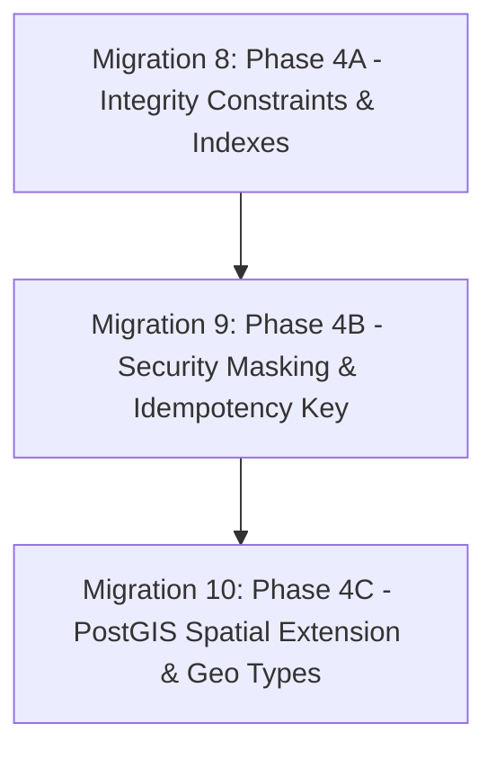

# LocalMan Platform: Database Migration Engineering & Forward Deployment Plan

**Author**: Principal Database Architect, Senior DevOps/PostgreSQL Engineer  
**Date**: November 1, 2026  
**ORM**: Prisma ORM 6.19.3 / PostgreSQL 16+  

---

## 1. Migration History & Lineage Audit

The LocalMan repository contains 7 historical sequential Prisma migrations:
1. `20261018000000_init`: Base marketplace schema (Users, roles, catalog, bookings, payments, reviews).
2. `20261018180000_phase_2e_financial_ledger`: Wallets, ledger entries, payouts, commission/TDS fields.
3. `20261018200000_phase_2f_realtime_dispatch`: Dispatch offers table and status enums.
4. `20261019120000_phase_2g_location_tracking`: Provider location logs table and indexes.
5. `20261019150000_phase_3c_booking_snapshots`: JSON snapshots (`address_snapshot`, `pricing_snapshot`, `service_snapshot`, `attachments`) and idempotency columns.
6. `20261020120000_phase_3i_chat_messaging`: Conversations, participants, messages, and transactional chat outbox.
7. `20261020140000_phase_3j_reviews_reputation`: Reviews moderation columns and `review_reports` table.

### Audit Invariant
* **RULE**: Existing applied migrations must **NEVER** be mutated, reordered, or edited. All architectural improvements must proceed strictly via **forward migrations** using the expand-and-contract pattern.

---

## 2. Proposed Forward Migration Sequence

To address all findings identified in the audit without causing downtime, data loss, or schema incompatibility, the improvements are structured into three phased forward migrations:



---

### Migration 8: `20261102000000_phase_4a_integrity_constraints`
* **Objective**: Add essential database check constraints, missing foreign-key indexes, and partial unique constraints.
* **Operations**:
  1. **Partial Unique Indexes**:
     * `addresses`: `CREATE UNIQUE INDEX uq_user_default_address ON addresses (user_id) WHERE is_default = TRUE;`
     * `booking_quotes`: `CREATE UNIQUE INDEX uq_booking_single_accepted ON booking_quotes (booking_id) WHERE status = 'ACCEPTED';`
     * `dispatch_offers`: `CREATE UNIQUE INDEX uq_booking_single_offered ON dispatch_offers (booking_id) WHERE status = 'OFFERED';`
  2. **Foreign Key Indexes**:
     * `provider_service_areas (provider_id)`
     * `provider_availability (provider_id)`
     * `booking_materials (booking_id)`
     * `refunds (payment_id)`
     * `provider_payouts (provider_id)`, `provider_payouts (booking_id)`
     * `complaints (booking_id)`, `complaints (raised_by)`
     * `audit_logs (user_id)`
     * `review_reports (reporter_id)`
  3. **Payment Lookup Indexes**:
     * `payments (gateway_payment_id) WHERE gateway_payment_id IS NOT NULL`
     * `payments (gateway_order_id) WHERE gateway_order_id IS NOT NULL`
  4. **Database Check Constraints**:
     * `provider_wallets`: `CHECK (available_balance_paisa >= 0 AND pending_balance_paisa >= 0 AND paid_out_balance_paisa >= 0)`
     * `payments`: `CHECK (amount_paisa > 0)`
     * `reviews`: `CHECK (rating >= 1 AND rating <= 5)`
     * `services`: `CHECK (base_price_paisa >= 0 AND platform_commission_percent >= 0 AND platform_commission_percent <= 100)`
     * `addresses`: `CHECK (latitude >= -90 AND latitude <= 90 AND longitude >= -180 AND longitude <= 180)`
* **Risk Assessment**: **LOW**. Check constraints must be preceded by a non-blocking validation query to confirm existing demo/production data satisfies the constraints.
* **Rollback Plan**: Dropping the added indexes and constraints is instant and zero-risk.

---

### Migration 9: `20261102120000_phase_4b_security_and_refund_idempotency`
* **Objective**: Add formal `idempotency_key` column to `refunds`, add masked columns for PII, and add optimistic locking `version` columns.
* **Operations**:
  1. **Refund Idempotency**:
     * `ALTER TABLE refunds ADD COLUMN idempotency_key VARCHAR(120);`
     * Backfill existing records: `UPDATE refunds SET idempotency_key = 'legacy_' || id WHERE idempotency_key IS NULL;`
     * Add unique constraint: `CREATE UNIQUE INDEX uq_refunds_idempotency_key ON refunds (idempotency_key);`
  2. **PII Masking**:
     * `ALTER TABLE provider_documents ADD COLUMN document_number_masked VARCHAR(20);`
     * Backfill: `UPDATE provider_documents SET document_number_masked = 'XXXX-' || RIGHT(document_number, 4);`
  3. **Optimistic Locking**:
     * `ALTER TABLE bookings ADD COLUMN version INTEGER NOT NULL DEFAULT 1;`
     * `ALTER TABLE provider_wallets ADD COLUMN version INTEGER NOT NULL DEFAULT 1;`
* **Risk Assessment**: **LOW**. Uses additive expand phase. Existing application code continues functioning seamlessly.
* **Rollback Plan**: Drop columns `idempotency_key`, `document_number_masked`, `version`.

---

### Migration 10: `20261103000000_phase_4c_postgis_spatial_foundation`
* **Objective**: Activate PostGIS extension, add native `geography(Point, 4326)` columns, and establish GiST spatial indexes.
* **Operations**:
  1. `CREATE EXTENSION IF NOT EXISTS postgis;`
  2. `ALTER TABLE providers ADD COLUMN location_geog geography(Point, 4326);`
  3. `ALTER TABLE addresses ADD COLUMN location_geog geography(Point, 4326);`
  4. Synchronize existing coordinates:
     ```sql
     UPDATE providers 
     SET location_geog = ST_SetSRID(ST_MakePoint(current_longitude, current_latitude), 4326)::geography
     WHERE current_latitude IS NOT NULL AND current_longitude IS NOT NULL;

     UPDATE addresses 
     SET location_geog = ST_SetSRID(ST_MakePoint(longitude, latitude), 4326)::geography;
     ```
  5. Add GiST spatial indexes:
     ```sql
     CREATE INDEX idx_providers_location_geog ON providers USING GIST (location_geog) 
     WHERE is_online = TRUE AND verification_status = 'VERIFIED';

     CREATE INDEX idx_addresses_location_geog ON addresses USING GIST (location_geog);
     ```
* **Risk Assessment**: **MEDIUM**. Requires PostgreSQL server with PostGIS binaries available (supported out of the box by Supabase, Neon, AWS RDS, and Google Cloud SQL).
* **Rollback Plan**: Drop GiST indexes and drop `location_geog` columns; keep PostGIS extension active.

---

## 3. Safe Expand-and-Contract Migration Checklist

Before executing any forward migration against staging or production:
1. [ ] Take full point-in-time PostgreSQL backup snapshot (`pg_dump -Fc`).
2. [ ] Verify table locks: Never run `ALTER TABLE ... ADD CONSTRAINT` without `NOT VALID` followed by `VALIDATE CONSTRAINT` on massive tables to avoid long exclusive locks.
3. [ ] Run pre-check scripts to ensure zero existing rows violate the new check constraint.
4. [ ] In production, create indexes using `CREATE INDEX CONCURRENTLY` to avoid blocking read/write transactions.
5. [ ] Execute Prisma schema generation (`npx prisma generate`) to update TypeScript types across all workspace packages.
6. [ ] Run full automated test suite to verify zero regressions.

