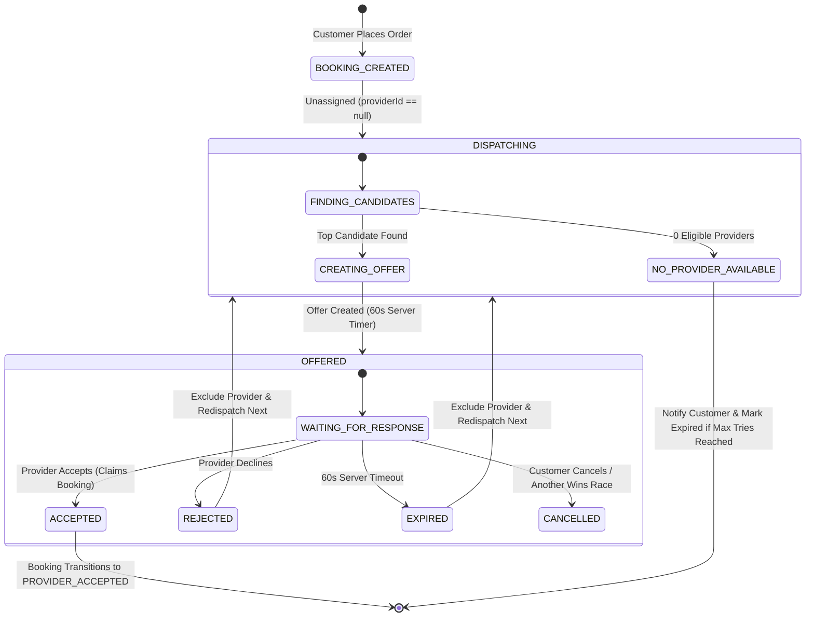

# LocalMan Real-Time Marketplace Dispatch & Provider Matching Architecture
**Phase 2F — Backend-Authoritative Dispatch & Matching Foundation**  
**Version:** 1.0.0  
**Status:** Authoritative Specification  

---

## 1. Executive Summary & Architectural Authority

The LocalMan real-time dispatch and provider matching engine guarantees that:
- The **backend PostgreSQL database is the sole authority** for dispatch offers, booking state transitions, provider claims, and candidate rankings.
- **Zero Client Authority:** Mobile apps (Customer App, Provider App) are pure presentation layers. Neither app can claim a job, advance booking states, bypass eligibility checks, or alter countdown deadlines.
- **Race-Condition & Concurrency Safety:** When multiple providers attempt to claim the same job or accept conflicting offers, PostgreSQL transaction boundaries guarantee that exactly one provider succeeds and all concurrent attempts receive explicit `409 Conflict` errors.

---

## 2. Dispatch State Machine & Booking Lifecycle Separation

The platform strictly isolates **Booking State**, **Dispatch Offer State**, and **Provider Operational State**:

### 2.1 State Matrix

| Domain Layer | Model / Property | Allowed States | Authority |
|---|---|---|---|
| **Booking State** | `Booking.currentStatus` | `REQUESTED`, `PROVIDER_ACCEPTED`, `CONFIRMED`, `PROVIDER_ON_THE_WAY`, `ARRIVED`, `JOB_STARTED`, `JOB_EXTENDED`, `JOB_COMPLETED`, `PAYMENT_PENDING`, `PAYMENT_SETTLED`, `REVIEWED`, `REJECTED`, `CANCELLED`, `EXPIRED` | Booking FSM (`booking-fsm.ts`) |
| **Dispatch Offer State** | `DispatchOffer.status` | `OFFERED`, `ACCEPTED`, `REJECTED`, `EXPIRED`, `CANCELLED` | Dispatch Service (`dispatch.service.ts`) |
| **Provider Operational State** | `Provider.isOnline`, `verificationStatus` | Online / Offline, `VERIFIED`, `DRAFT`, `SUSPENDED` | Provider Service (`provider.service.ts`) |

### 2.2 Dispatch Flow Diagram

---

## 3. Provider Eligibility Rules

A provider is evaluated against strict server-authoritative criteria immediately before an offer is dispatched and re-validated at offer acceptance:

1. **User Account Active:** `provider.user.isActive === true`.
2. **KYC Verified & Unbroken Status:** `provider.verificationStatus === 'VERIFIED'` and `provider.verificationStatus !== 'SUSPENDED'`. Unverified partners cannot go on duty or receive jobs.
3. **On-Duty / Online Status:** `provider.isOnline === true`.
4. **Service Compatibility:** Provider has an active service entry in `ProviderService` with `serviceId === booking.serviceId` and `isEnabled === true`.
5. **Service Area Compatibility:** Provider has a `ProviderServiceArea` matching the booking address city or within the `serviceRadiusMeters` radius (using Haversine distance).
6. **Workload / Busy Protection:** Provider does not have any ongoing job in `['PROVIDER_ON_THE_WAY', 'ARRIVED', 'JOB_STARTED', 'JOB_EXTENDED']`.
7. **Active Offer Lock:** Provider is not currently evaluating another unexpired `OFFERED` dispatch offer.
8. **Anti-Self-Booking Guard:** `provider.userId !== booking.customerId`.
9. **Rejection History:** Provider has not previously declined or rejected this specific booking.

---

## 4. Matching & Scoring Algorithm (`MatchingService`)

The matching system implements an extensible interface (`IMatchingScorer`) to allow pluggable machine-learning or heuristic ranking in future phases:

### Current Default Scoring Formula:

$$\text{Score} = (\text{Rating} \times 20) + (\min(\text{ExperienceYears}, 10) \times 2) - (\text{DistanceKm} \times 2)$$

- **Rating Base:** Standardized 0–100 base score from provider's 5-star rating.
- **Experience Bonus:** Up to +20 points for professional experience.
- **Distance Penalty:** Haversine distance in kilometers reduces score, prioritizing closer partners.
- **Deterministic Ranking:** The candidate with the highest calculated score receives the initial offer (`attemptNumber = 1`).

---

## 5. Dispatch Offer Lifecycle & Atomic Claiming

### 5.1 Offer Attributes
- **`id`**: Unique UUID PK
- **`bookingId`**: References `Booking`
- **`providerId`**: References `Provider`
- **`status`**: `OFFERED` $\rightarrow$ `ACCEPTED` / `REJECTED` / `EXPIRED` / `CANCELLED`
- **`attemptNumber`**: Integer sequence of dispatch attempts
- **`expiresAt`**: Authoritative server deadline (default: `now() + 60 seconds`)
- **`respondedAt`**: Server timestamp of provider response
- **`rejectionReason`**: Audit string if declined

### 5.2 Atomic Claim Transaction (Race Condition Safety)
When a provider accepts an offer via `POST /api/v1/providers/dispatch/offers/:id/accept`:

1. Begins PostgreSQL database transaction (`$transaction`).
2. Validates offer ownership: `offer.providerId === provider.id`.
3. Checks offer status: `offer.status === 'OFFERED'`.
4. Checks expiration: `now() < offer.expiresAt`.
5. Re-validates provider eligibility (ensuring partner did not go offline or pick up another job in the interim).
6. **Atomic Booking Lock:** Checks `booking.currentStatus === 'REQUESTED'` and `booking.providerId === null`.
   - If another provider claimed the booking in a parallel request, the transaction aborts with `409 Conflict ("This booking has already been claimed by another service partner")` and marks the loser's offer `CANCELLED`.
7. **Assignment & Status Advance:** Updates `booking.providerId = provider.id` and `booking.currentStatus = 'PROVIDER_ACCEPTED'`.
8. **Offer Settlement:** Sets `offer.status = 'ACCEPTED'`.
9. **Concurrent Offer Cancellation:** Sets all other active offers for this booking to `CANCELLED`.
10. **Audit History:** Appends immutable record in `BookingStatusHistory`.
11. Emits `BOOKING_ACCEPTED` real-time event and sends push notification to customer.

---

## 6. Offer Expiration & Redispatch

1. **Authoritative Expiration:** The mobile app's countdown timer is cosmetic. Only the backend `expiresAt` timestamp determines validity.
2. **Periodic Stale Sweep (`expireStaleOffers`):** An administrative / worker query scans:
   $$\text{status} = \text{'OFFERED'} \quad \text{AND} \quad \text{expiresAt} \le \text{now}()$$
3. For each stale offer:
   - Sets `offer.status = 'EXPIRED'`.
   - Sends expiration notification to the timed-out provider.
   - Automatically triggers `dispatchBooking(offer.bookingId)` to select and notify the next highest-scoring eligible candidate.
   - If maximum attempts ($\ge 5$) or all eligible providers are exhausted, triggers `DISPATCH_FAILED` event to notify the customer.

---

## 7. Real-Time Transport & Notification Architecture

### 7.1 Real-Time Transport (`RealtimeService`)
- Implemented as an in-memory Pub/Sub event bus with channel routing:
  - `provider:<providerId>` — Dispatched offers, cancellations, balance credits.
  - `customer:<customerId>` — Partner assignment, dispatch status updates.
  - `booking:<bookingId>` — Status changes, transit updates.
- **Server-Sent Events (SSE) Stream:** Providers listen via `GET /api/v1/providers/dispatch/stream`. Requires authenticated JWT and provider profile.

### 7.2 Push Notification Architecture (`NotificationService`)
- Clean `INotificationProvider` interface.
- **Safe Development Adapter (`DevNotificationAdapter`):** Records in-memory notification audit log and pipes to `RealtimeService` without pretending production FCM credentials exist.
- **Production Isolation:** Production FCM credentials will be injected via configuration in future deployment phases without altering business logic.

---

## 8. Role of Redis vs PostgreSQL

- **PostgreSQL is Authoritative:** All bookings, offers, provider states, and history remain strictly persisted in PostgreSQL.
- **Redis (Transient / Cache):** Redis is reserved for transient pub/sub scaling and distributed rate-limiting across clustered API workers. It never holds authoritative financial or booking state.

---

## 9. Provider Mobile App Integration

- **Screen:** `ProviderDashboardScreen`
- **Incoming Offer Card:**
  - Displays service name, booking number, payout amount, location, and scheduled slot.
  - Displays dynamic countdown timer bound to the server's `expiresAt` deadline.
  - **Accept Job:** Calls `POST /providers/dispatch/offers/:id/accept`. On success, navigates to `/job/:id`. On race loss (409) or timeout (422), displays error alert and re-queries active jobs.
  - **Decline Job:** Calls `POST /providers/dispatch/offers/:id/reject`.
- **Zero Client Math:** All prices, distances, and deadlines come pre-calculated from the server.

---

## 10. Phase 2G Location Boundary Note

Phase 2F matching utilizes current coordinates stored on `Provider` and `Address` when available. Comprehensive background GPS, location permissions, geofencing, breadcrumb tracking, and PostGIS spatial indexing are explicitly deferred to **Phase 2G (Provider Live Location & Tracking)**.
