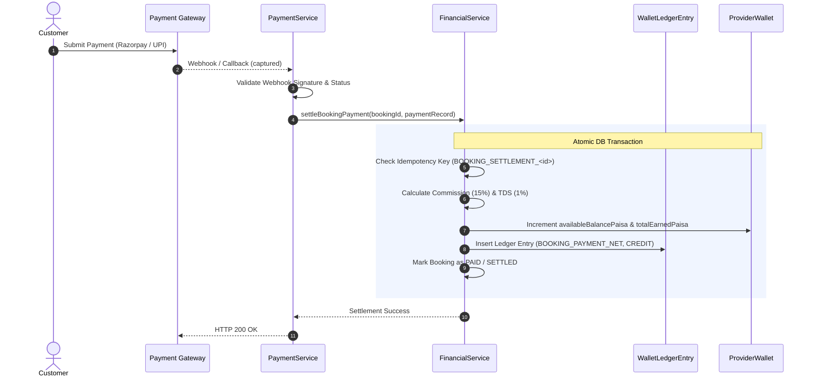

# LocalMan Financial Architecture & Ledger Specification
**Phase 2E — Financial Ledger, Provider Wallet & Payout Foundation**  
**Version:** 1.0.0  
**Status:** Authoritative Specification  

---

## 1. Executive Summary & Financial Authority

In LocalMan, the backend database is the **sole authoritative entity** for all financial states, calculations, wallet balances, commission splits, tax deductions, and payout allocations. 

- **Zero Client Authority:** Mobile clients (Customer App, Provider App) and Web Admin interfaces are strictly presentation layers. They never perform financial math, determine payout eligibility, or submit balance mutations.
- **Strict Server Authoritative Flow:** Every balance change is executed inside an atomic PostgreSQL database transaction backed by immutable ledger entries.
- **Historical Reproducibility:** Historical financial records preserve the exact percentage rates applied at the time of settlement (`appliedCommissionRate`, `appliedTdsRate`), ensuring financial auditability even if platform fee structures change in the future.

---

## 2. Minor Unit Representation (Paisa Invariant)

All monetary amounts across the LocalMan platform (database schema, Prisma client, backend API contracts, event payloads, and mobile models) are stored and manipulated as **integers in minor currency units (Indian Paisa)**.

$$\text{1 INR} = 100\text{ Paisa}$$

### Principles:
1. **Never Float:** No floating-point types (`Float`, `Double`, `Number` with decimals) are used for financial balances or ledger amounts. Prisma columns use `Int` or `BigInt`.
2. **Rounding Rule:** All fee splits (commission paisa, TDS paisa) use standard integer rounding:
   $$\text{Fee Paisa} = \mathrm{round}\left(\frac{\text{Base Paisa} \times \text{Rate Percentage}}{100}\right)$$
3. **No Phantom Paisa:** Deductions cannot exceed the gross amount. Balance invariants guarantee that:
   $$\text{Gross Amount} = \text{Platform Fee} + \text{TDS Amount} + \text{Provider Net Earning}$$

---

## 3. Commission Rate Resolution: 15.00% Baseline vs 10% Discrepancy

### 3.1 Audit Findings & Context
During Phase 2D audits, a reference to a "10% platform commission" was noted in test mocks. A comprehensive audit across the codebase revealed:
1. **Prisma Schema:** `Category.platformCommissionPercent` default is `15.00` (`Decimal(5,2)`).
2. **Database Seeds:** `seed.ts` seeds default category commissions at `15.00%`.
3. **Contracts:** Default platform commission in catalog schemas is documented and defaulted to `15.00%`.
4. **Phase 2D Discrepancy Origin:** A single mock test (`phase-2d.test.ts` test #15) injected a fixed test fixture with `platformFeePaisa: 17000` on a total amount of `170000` (10%) for a specific booking mock, which led to the mention in the Phase 2D report.

### 3.2 Authoritative Resolution
- **Platform Baseline:** The canonical, authoritative LocalMan platform commission rate is **15.00%**.
- **Tiered Overrides:** LocalMan supports category-level, service-level, and provider-specific promotional commission overrides (configured in backend metadata).
- **Rate Immutability Guarantee:** When a booking is settled, the actual percentage rate applied is permanently stamped onto the booking, the ledger entry, and the payout record (`appliedCommissionRate`, e.g., `15.00`). Historical transactions are never altered or recalculated retroactively if commission rates are adjusted.

---

## 4. Statutory TDS (Tax Deducted at Source) Under Section 194O

In accordance with Section 194O of the Indian Income Tax Act for e-commerce operators facilitating services through resident service providers:

- **TDS Rate:** 1.00% (`1.00%` baseline rate for PAN-verified providers).
- **Application Base:** Calculated on the **Provider Gross Earning** (or Total Service Value credited to the participant):
  $$\text{TDS Paisa} = \mathrm{round}\left(\frac{\text{Provider Gross Earning Paisa} \times \text{TDS Rate}}{100}\right)$$
- **Applied Rate Stamping:** Stamped permanently as `appliedTdsRate` (e.g. `1.00`) in `WalletLedgerEntry` and `BookingFinancialBreakdown`.
- **Statutory Remittance:** TDS debited from the provider's earnings is credited into the platform's statutory tax liability reserve account for periodic governmental remittance.

---

## 5. Complete Financial Breakdown Formula

For any completed booking with base amount and approved extra material charges:

1. **Total Booking Amount:**
   $$\text{Total Amount Paisa} = \text{Base Amount Paisa} + \text{Approved Material Paisa}$$
2. **Platform Commission:**
   $$\text{Platform Commission Paisa} = \mathrm{round}\left(\frac{\text{Base Amount Paisa} \times \text{Commission Rate}}{100}\right)$$
   *(Note: Material charges are passed through without commission markup unless specified by platform policy).*
3. **Provider Gross Earning:**
   $$\text{Gross Earning Paisa} = \text{Total Amount Paisa} - \text{Platform Commission Paisa}$$
4. **Statutory TDS:**
   $$\text{TDS Paisa} = \mathrm{round}\left(\frac{\text{Gross Earning Paisa} \times \text{TDS Rate}}{100}\right)$$
5. **Provider Net Earning (Authoritative Wallet Credit):**
   $$\text{Net Earning Paisa} = \text{Gross Earning Paisa} - \text{TDS Paisa}$$

---

## 6. Financial Ledger Architecture (`WalletLedgerEntry`)

LocalMan implements an append-only, immutable financial ledger. Ledger entries cannot be updated or deleted. Corrections are made strictly via offsetting compensatory entries.

### 6.1 Ledger Entry Schema

| Field | Type | Description |
|---|---|---|
| `id` | UUID (PK) | Unique immutable entry identifier |
| `walletId` | UUID (FK) | Reference to `ProviderWallet` |
| `providerId` | UUID (FK) | Reference to `Provider` |
| `bookingId` | UUID (FK, Nullable) | Associated booking reference |
| `payoutId` | UUID (FK, Nullable) | Associated payout request reference |
| `entryType` | `LedgerEntryType` Enum | Categorization of transaction |
| `direction` | `LedgerDirection` Enum | `CREDIT` (+) or `DEBIT` (-) |
| `amountPaisa` | Integer | Positive minor unit amount |
| `balanceAfterPaisa`| Integer | Wallet available balance immediately after entry |
| `currency` | String | Fixed to `"INR"` |
| `idempotencyKey` | String (Unique) | Dedup key preventing duplicate applications |
| `referenceId` | String (Nullable) | External reference (Payment Intent ID, Bank UTR) |
| `appliedCommissionRate` | Decimal (Nullable) | Rate applied for booking settlements (e.g., 15.00) |
| `appliedTdsRate` | Decimal (Nullable) | TDS rate applied (e.g., 1.00) |
| `description` | String | Human/audit-readable narrative |
| `metadata` | JSON | Extended audit trail (Admin ID, adjustment reason) |
| `createdAt` | Timestamp | Immutable creation timestamp |

### 6.2 Ledger Entry Types

- `BOOKING_PAYMENT_NET`: Net earnings credited to provider from settled booking.
- `PLATFORM_COMMISSION`: Record of platform commission retained.
- `STATUTORY_TDS`: Record of income tax withheld at source.
- `PAYOUT_REQUESTED`: Funds reserved/debited from available balance for bank transfer.
- `PAYOUT_SETTLED`: Successful payout finalized.
- `PAYOUT_REVERSED`: Failed/cancelled payout refunded back to available balance.
- `REFUND_DEDUCTION`: Customer refund clawback from provider balance.
- `MANUAL_ADJUSTMENT`: Admin intervention with audited reason.

---

## 7. Provider Wallet Architecture (`ProviderWallet`)

Each verified service provider has exactly one `ProviderWallet`.

### 7.1 Balances Maintained
- **`availableBalancePaisa`**: Liquid funds eligible for withdrawal or payout.
- **`pendingBalancePaisa`**: Escrowed earnings from active or dispute-held jobs before final release.
- **`paidOutBalancePaisa`**: Cumulative total paisa successfully transferred to the provider's external bank account.
- **`totalEarnedPaisa`**: Cumulative lifetime net earnings.

### 7.2 Strict Financial Invariant
The wallet balances must remain strictly consistent with the underlying ledger:

$$\text{Sum of all non-reversed Credits} - \text{Sum of all non-reversed Debits} = \text{availableBalancePaisa}$$

$$\text{totalEarnedPaisa} = \text{availableBalancePaisa} + \text{paidOutBalancePaisa} + (\text{active pending withdrawals})$$

Balances can never be negative. Any operation that would drive `availableBalancePaisa < 0` triggers an immediate atomic rollback with an `InsufficientBalanceError`.

---

## 8. End-to-End Payment to Earning Flow



---

## 9. Provider Payout Lifecycle & State Machine

LocalMan models payouts as an explicit state machine with atomic balance reservations:

```mermaid
stateDiagram-v2
    [*] --> PENDING: Provider Requests Payout
    note right of PENDING: availableBalance debited atomically<br/>Ledger: PAYOUT_REQUESTED (DEBIT)
    
    PENDING --> PROCESSING: Admin / Batch Payout Initiated
    
    PROCESSING --> PAID: Bank Gateway Confirms Transfer (UTR received)
    note right of PAID: paidOutBalance incremented<br/>payout marked final
    
    PROCESSING --> FAILED: Bank Transfer Fails / Rejected
    note right of FAILED: availableBalance refunded atomically<br/>Ledger: PAYOUT_REVERSED (CREDIT)
    
    PENDING --> FAILED: Provider Cancels or Verification Fails
    note right of FAILED: availableBalance refunded atomically<br/>Ledger: PAYOUT_REVERSED (CREDIT)

    PAID --> [*]
    FAILED --> [*]
```

### 9.1 Payout Safety Invariants
1. **Atomic Fund Reservation:** When a payout is requested (`POST /api/v1/providers/wallet/payouts`), funds are immediately debited from `availableBalancePaisa`. This guarantees two simultaneous payout requests cannot double-spend the same balance.
2. **No Real Payout Execution in Phase 2E:** Phase 2E implements the complete domain lifecycle, state machine, idempotency, and database invariants. No external banking API is invoked without explicit operator approval and production credentials.
3. **Idempotent Status Transitions:** Updating a payout status (`PENDING -> PROCESSING`, `PROCESSING -> PAID`, `PROCESSING -> FAILED`) checks the current state; duplicate callbacks or retries are rejected safely.

---

## 10. Admin Financial Visibility & Manual Adjustments

Administrators have comprehensive audit capabilities:
- **`GET /api/v1/admin/financial/wallets/:providerId`**: Full wallet overview, pending withdrawals, lifetime volume.
- **`GET /api/v1/admin/financial/ledger`**: Queryable ledger with filters by provider, entry type, and date range.
- **`GET /api/v1/admin/financial/payouts`**: Listing of all payout requests across states (`PENDING`, `PROCESSING`, `PAID`, `FAILED`).
- **`POST /api/v1/admin/financial/adjustments`**: Manual adjustments require:
  - Valid Admin authentication & permission.
  - Mandatory audit reason string.
  - Recording of `adminUserId` in ledger metadata.
  - Creation of an immutable `MANUAL_ADJUSTMENT` ledger entry.

Arbitrary balance editing without an audited ledger entry is strictly blocked at the service and database layer.

---

## 11. Security & IDOR Protections

1. **Provider Boundary Enforcement:**
   - Provider endpoints (`/wallet`, `/wallet/payouts`, `/wallet/ledger`) strictly derive the `providerId` from the verified session token (`req.user.providerId`).
   - If an authenticated user is not a registered provider, access is denied (`403 Forbidden`).
   - Providers cannot view or request payouts against another provider's wallet.
2. **Idempotency Keys:**
   - Webhook processing generates canonical idempotency keys (e.g., `PAYMENT_SETTLEMENT_<paymentIntentId>`).
   - Payout requests require an `idempotencyKey` parameter or generate a unique deterministic key to prevent duplicate clicks from creating dual debit requests.
3. **Replay & Concurrency Safety:**
   - High-concurrency withdrawal attempts are isolated using PostgreSQL transaction isolation and row locking (`SELECT ... FOR UPDATE` semantics on the provider wallet).
