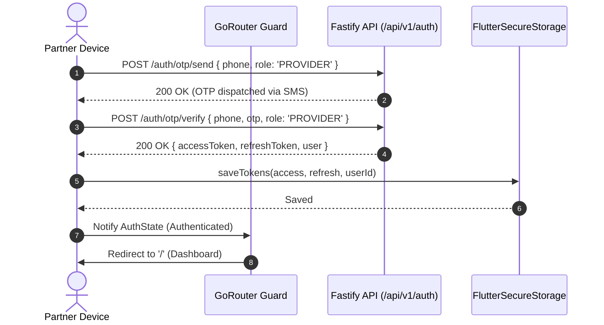

# LocalMan Provider Mobile Application Architecture (Phase 1 Foundation)

This document specifies the production architecture, security controls, and integration contracts for the **LocalMan Partner / Provider Mobile Application** ([`apps/provider_app`](file:///c:/Users/hp/OneDrive/Desktop/antigravity%20workspace/localman/apps/provider_app)).

---

## 1. Directory & Layering Structure

```
apps/provider_app/
├── android/                             # Native Android platform scaffolding
│   └── app/
│       ├── build.gradle                 # namespace "in.localman.provider", minSdk 21, compileSdk 34
│       └── src/main/
│           ├── AndroidManifest.xml      # Scoped INTERNET permission, singleTop launchMode
│           └── kotlin/in/localman/provider/MainActivity.kt
├── ios/                                 # Native iOS platform scaffolding
│   └── Runner/
│       ├── Info.plist                   # Bundle ID: in.localman.provider
│       └── AppDelegate.swift
├── lib/
│   ├── core/
│   │   ├── config/                      # Environment configuration & release security rules
│   │   │   └── env_config.dart
│   │   ├── constants/                   # Dynamic API endpoints and route definitions
│   │   │   └── api_constants.dart
│   │   ├── errors/                      # Structured API errors and strongly typed exceptions
│   │   │   ├── api_error.dart
│   │   │   └── app_exception.dart
│   │   ├── network/                     # Dio HTTP client with PII-sanitized logging & AuthInterceptor
│   │   │   ├── api_client.dart
│   │   │   └── auth_interceptor.dart
│   │   ├── routing/                     # GoRouter configuration with authenticated route guards
│   │   │   └── app_router.dart
│   │   ├── storage/                     # Secure token persistence (flutter_secure_storage)
│   │   │   └── token_storage.dart
│   │   └── theme/                       # Design tokens, typography, and color schemes
│   │       └── app_theme.dart
│   ├── features/
│   │   ├── auth/
│   │   │   ├── data/                    # IAuthRepository & AuthRepository implementation
│   │   │   │   └── auth_repository.dart
│   │   │   ├── domain/                  # AuthState & AuthNotifier (Riverpod)
│   │   │   │   └── auth_state.dart
│   │   │   └── presentation/screens/    # Login & OTP screens (real API validation, zero bypasses)
│   │   │       ├── provider_login_screen.dart
│   │   │       └── provider_otp_screen.dart
│   │   ├── dashboard/
│   │   │   └── presentation/screens/    # Partner dashboard, duty switch, and authenticated profile
│   │   │       └── provider_dashboard_screen.dart
│   │   ├── jobs/
│   │   │   └── presentation/screens/    # Job execution, Start OTP validation, material submissions
│   │   │       ├── active_job_execution_screen.dart
│   │   │       └── incoming_job_radar_dialog.dart
│   │   ├── kyc/
│   │   │   └── presentation/screens/    # Aadhaar/PAN/Bank verification (sanitized inputs)
│   │   │       └── provider_kyc_screen.dart
│   │   └── wallet/
│   │       └── presentation/screens/    # Read-only ledger, backend financial authority notice
│   │           └── provider_wallet_screen.dart
│   ├── shared/
│   │   └── models/                      # Strongly typed data models (Paisa to Rupee calculations)
│   │       ├── auth_session.dart
│   │       ├── user_model.dart
│   │       ├── provider_model.dart
│   │       ├── booking_model.dart
│   │       └── wallet_model.dart
│   └── main.dart                        # Application bootstrap wrapped in ProviderScope
├── test/                                # Unit tests for TokenStorage, Models, and Auth
│   ├── token_storage_test.dart
│   ├── model_serialization_test.dart
│   └── auth_repository_test.dart
└── pubspec.yaml                         # Project dependencies and asset declarations
```

---

## 2. State Management Approach

- **Framework:** `flutter_riverpod` (`2.5.1`).
- **Separation of Concerns:**
  - Business and session state are managed by Riverpod `StateNotifier` / `Notifier` classes (`authNotifierProvider`).
  - Ephemeral widget-only animation or controller state uses `ConsumerStatefulWidget` without storing business data in widgets.
  - The UI layer does **not** make direct HTTP calls; it interacts strictly with repository abstractions provided through Riverpod.

---

## 3. Network Architecture & Token Lifecycle

### 3.1 Dio API Client
- Standardized timeouts configured via `EnvConfig`:
  - `connectTimeout: 15s`
  - `receiveTimeout: 15s`
  - `sendTimeout: 15s`
- Structured error handling: All HTTP failures are mapped into typed `AppException` and `ApiError` instances containing HTTP status code, backend error code, and localized message.

### 3.2 Authentication Interceptor (`AuthInterceptor`)
- **Bearer Token Injection:** Automatically attaches `Authorization: Bearer <accessToken>` to all non-auth endpoints.
- **Centralized 401 Handling & Refresh:**
  1. Catches HTTP 401 responses on authenticated requests.
  2. Spawns an isolated refresh request to `POST /api/v1/auth/refresh` using the secure `refreshToken`.
  3. If refresh succeeds: updates secure storage and retries the original request seamlessly.
  4. If refresh fails: wipes tokens from `TokenStorage` and triggers `onSessionExpired()`, forcing an immediate redirect to `/login`.

### 3.3 Token Storage (`TokenStorage`)
- Backed by `flutter_secure_storage`:
  - Android: `EncryptedSharedPreferences` with Android Keystore master key.
  - iOS: Keychain with `kSecAttrAccessibleAfterFirstUnlock`.
- Sensitive tokens are **never** stored in `SharedPreferences` or plaintext files.

---

## 4. Authentication Flow & Route Protection



### Route Guard Enforcement
- In `app_router.dart`, GoRouter inspects `ref.watch(authNotifierProvider).isAuthenticated`:
  - Unauthenticated access to `/`, `/job/:id`, `/wallet`, or `/kyc` triggers an immediate redirect to `/login`.
  - Authenticated partners on `/login` or `/otp` are automatically redirected to `/`.

---

## 5. Security & Privacy Rules

1. **Production HTTPS Enforcement:**
   In release builds (`kReleaseMode`), `EnvConfig.baseUrl` throws a runtime error if `API_BASE_URL` does not start with `https://`.
2. **PII Sanitization in Network Logs:**
   Network logging is disabled in release builds. In debug builds, sensitive keys (`otp`, `authorization`, `accessToken`, `aadhaar`, `pan`, `bankAccount`, `upiId`) are redacted to `[REDACTED_SENSITIVE]`.
3. **Zero Demo Bypasses:**
   The universal OTP acceptance (`123456`) and client-side authentication bypasses have been completely removed.
4. **Backend Financial Authority:**
   All financial values (labor rate, commission deduction, TDS, material approval, wallet balances) are computed and authorized exclusively by the backend. The mobile app functions strictly as a presentation client.
5. **No Hardcoded Production Secrets:**
   Backend `env.ts` enforces that default development passwords and keys (`JWT_SECRET`, `RAZORPAY_KEY_SECRET`, `DATABASE_URL`) cause a boot crash if executed with `NODE_ENV=production`.

---

## 6. How to Run & Verify

```bash
# Verify backend unit tests and FSM validation
npm.cmd test

# Verify monorepo build and TypeScript contracts
npm.cmd run build

# Run Provider Flutter tests (when Flutter SDK is available on host)
cd apps/provider_app
flutter analyze
flutter test
```
